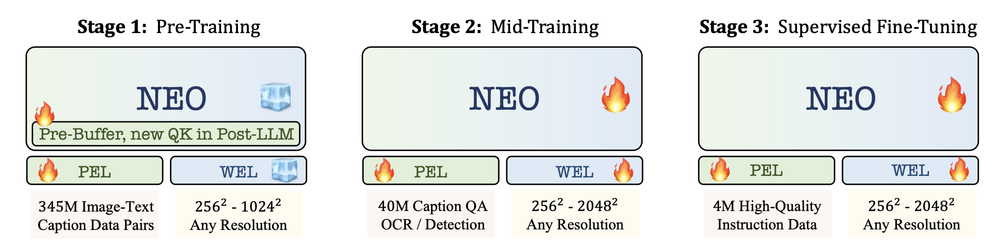

# VTCNativeEval: A Structured Study of Visual Token Compression Methods for Native VLMs

## Project Proposal

### Current benchmark/evaluation

[Arxiv 2025] [UniPruneBench](https://arxiv.org/abs/2511.02650):

1. underrated baseline: *"Random pruning remains a surprisingly strong baseline."*
2. no consistent winner: *"No single method achieves universal superiority."*

[ACL 2026] [VTC-Bench](https://aclanthology.org/2026.acl-long.195): 

1. filter "too hard" questions: *"drop out the samples answered incorrectly at the original resolution, which we consider are too hard for the original models to understand."* 
2. decouple "hard" and "easy" questions: *Difficult Samples (Group A): Samples that are answered incorrectly by the downsampling method* and vice versa.

**🍊🍊🍊Limitations of current evaluation/benchmarking** - no evaluation on Native VLMs (i.e., encoder-free VLMs). We can focus on NEO model from [https://arxiv.org/pdf/2510.14979](https://arxiv.org/pdf/2510.14979):




## Environment Setup

We closely follow the setup from [NEO repository](https://github.com/EvolvingLMMs-Lab/NEO/blob/main/VLMEvalKit/docs/en/Quickstart.md) to set up the environment:

```bash
module load miniconda3/24.1.2-py310
conda create -n neo pip python=3.10
conda activate neo
cd VLMEvalKit
python -m pip install -e .
python -m pip install transformers==4.57.1
```

## VLM Evaluation

We can run one-liner evaluation:

```bash
salloc --nodes=1 --ntasks-per-node=1 --gpus-per-node=1 -A PAS2836 --partition debug-nextgen --time 00:10:00
module load miniconda3/24.1.2-py310
conda activate neo
cd VLMEvalKit
export LMUData=/fs/scratch/PAS2836/yusenpeng_dataset/VLMEvalKit_data
# MMBench
python run.py --data MMBench_DEV_EN --model NEO-2B-SFT --verbose
# MME
python run.py --data MME --model NEO-2B-SFT --verbose
# MMMU
python run.py --data MMMU_DEV_VAL --model NEO-2B-SFT --verbose
# RealWorldQA
python run.py --data RealWorldQA --model NEO-2B-SFT --verbose
# TextVQA
python run.py --data TextVQA_VAL --model NEO-2B-SFT --verbose
# DocVQA
python run.py --data DocVQA_VAL --model NEO-2B-SFT --verbose
# OCRBench
python run.py --data OCRBench --model NEO-2B-SFT --verbose
# ChartQA
python run.py --data ChartQA_TEST --model NEO-2B-SFT --verbose
```


Or run all jobs concurrently with SLURM:

```bash
bash VTCeval_scripts/eval_all.sh <model_name>
```

Measure FLOPs:

```bash
cd VLMEvalKit && python ../scripts/flops.py
```

## Continued SFT

Let's get started with training! We need to first configure [VLMEvalKit/vlmeval/VLMTrainKit/SFT.sh](VLMEvalKit/vlmeval/VLMTrainKit/SFT.sh).

Really two things need to change/update here: ``vtc_method`` and ``compression_ratio``. For fixed pooling under 2x, we can simply do:

```bash
args=(
    ...
    --vtc_method fixed
    --compression_ratio 0.5
)
```

We can (and we should, full-parameter is expensive) run the training experiment with LoRA:

```bash
# basic SFT
sbatch VLMEvalKit/vlmeval/VLMTrainKit/SFT.sh
# SFT + distillation
sbatch VLMEvalKit/vlmeval/VLMTrainKit/SFT_w_distillation.sh
```

